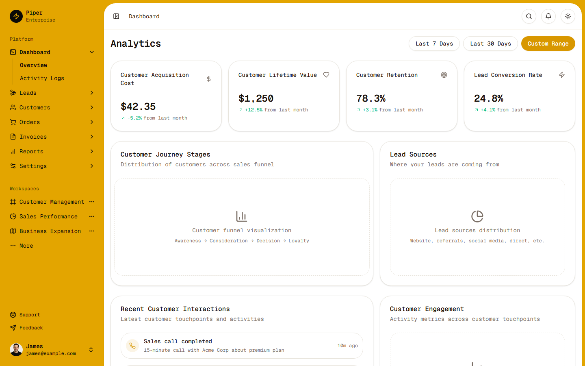
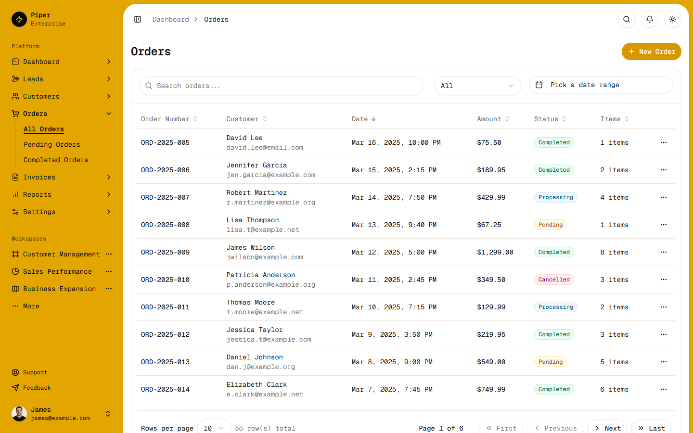
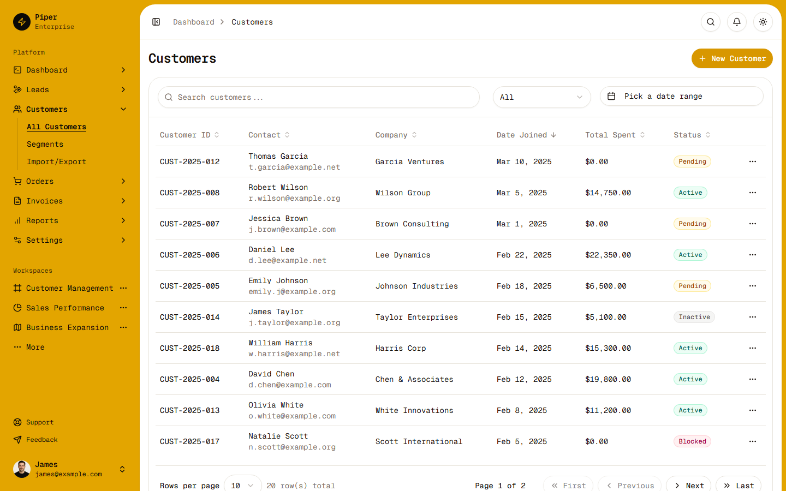
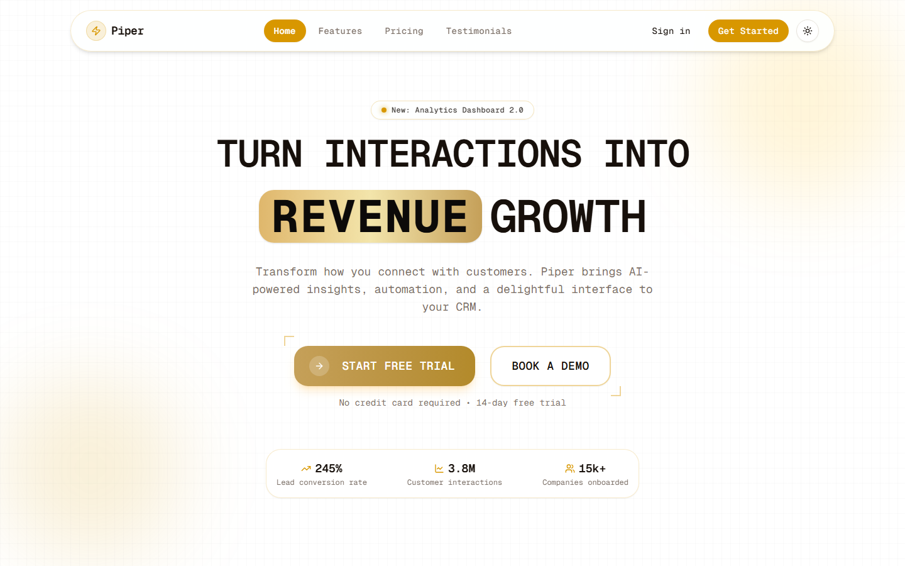
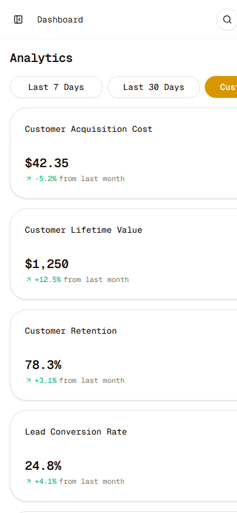
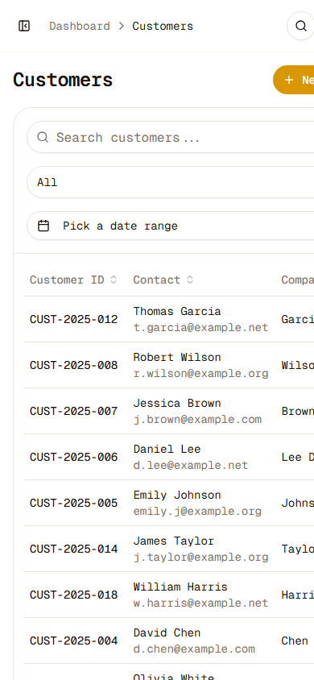
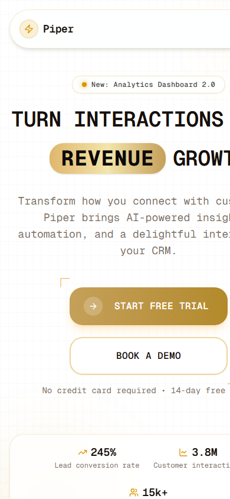

# Piper Enterprise CRM - UI

An ultra-premium CRM dashboard and landing page built with Next.js 15, React 19, and Tailwind CSS, featuring an elegant Gold & White design system for managing customer relationships, sales pipelines, orders, and real-time analytics.

## Features

- **Modern UI**: Built with Shadcn UI components, Tailwind CSS v4, and a luxury Gold & White palette
- **Responsive Design**: Fully responsive dashboard that works on all devices
- **Dashboard Analytics**: Visual representations of key metrics and customer data
- **Multiple Modules**: Customers, Invoices, Leads, Orders, and more
- **Dark Mode Support**: Toggle between light (Gold & White) and dark (Obsidian & Gold) themes

## Screenshots

### Dashboard Views




### Landing Page


### Mobile Experience
<div style="display: flex; justify-content: space-between;">
  
  
  
</div>

## Project Structure

```
src/
├── app/                 # Next.js App Router
│   ├── dashboard/       # Dashboard routes
│   └── page.tsx         # Landing page
├── components/
│   ├── ui/              # Shadcn UI components
│   └── shared/          # Shared components
├── features/
│   ├── dashboard/       # Dashboard feature components
│   │   ├── components/  # Dashboard UI components 
│   │   └── pages/       # Dashboard page components
│   └── landing/         # Landing page components
```

## Tech Stack

- **Framework**: Next.js 15.5.28 with React 19
- **Styling**: Tailwind CSS
- **UI Components**: Shadcn UI with Radix UI primitives

## Getting Started

First, run the development server:

```bash
npm run dev
# or
yarn dev
# or
pnpm dev
# or
bun dev
```

Open [http://localhost:3000](http://localhost:3000) with your browser to see the result.

## Deploy on Vercel

The easiest way to deploy your Next.js app is to use the [Vercel Platform](https://vercel.com/new).
